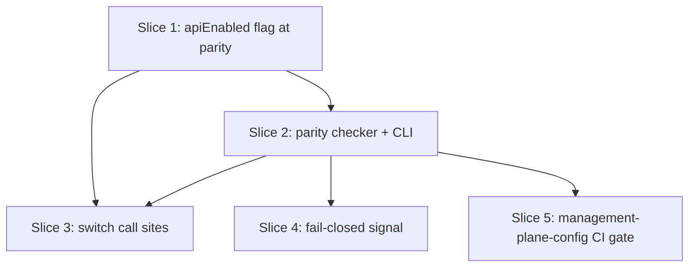

# Plan: Secure-by-default API enablement (`apiEnabled`)

**Created**: 2026-11-17
**Branch**: `feat/api-enabled-secure-default` (to be created at build; currently on `main`)
**Status**: implemented
**Gherkin persistence**: e2e/features
**Scope enforcement**: none

## Goal

Replace the enabled-by-default `apiDisabled` posture with secure-by-default
enablement via a new positive flag `apiEnabled` (embedded, default off). In-repo
work: the flag and its parity rules, an automated parity checker (with a CLI
entrypoint), the runtime call-site switch, and a fail-closed operator signal.
Cross-repo work: a `management-plane-config` CI gate that runs the checker
against every landscape config. The post-rollout removal of `apiDisabled` is a
deferred follow-up tracked under Risks. Trunk stays releasable after every
slice: the flag is added at behavioral parity before any caller reads it, so the
switch is a no-op on existing clusters and is reversible by reverting the binary.

**Approach stances** (high-reversal-cost axes, per `decision-defaults.md`):
- **Replace vs. merge / migrate vs. stub**: additive, expand-before-contract — `apiEnabled` coexists with `apiDisabled` through a bounded dual-flag window; no in-place inversion.
- **Scope**: narrow — the `apiDisabled` API-gating flag only; other GoFF flags untouched (per spec).
- **Format fidelity**: preserve the existing GoFF YAML schema; `make test-ff` must stay green.
- **Integration (auto-merge vs. direct)**: default — PR with auto-merge gated on green checks.

## Build Amendment — 2026-11-17 (operator-DX, approved mid-build)

Decided with the user while building Slice 1, optimizing for sovereign-cloud
operators who author their own feature-flag config without the SAP
`management-plane-config` pipeline:

- **Foundational + infra enablement is hardcoded in the binary, not in config.**
  `feature == ""` (IpRange, CloudResources root) and `feature == "unknown"`
  (unmapped infra manifests: RBAC, namespaces, base CRDs) are always enabled via
  the shared gate predicate (same pattern as the existing `cloudresources`
  bootstrap override), in BOTH `ApiEnabled` (→true) and `ApiDisabled` (→false) so
  parity holds by construction. They are REMOVED from `ff_ga.yaml`'s allowlist.
  Rationale: an operator's config should list only the customer-facing feature
  APIs; it must not be able to knock out the platform substrate by omitting a
  magic entry, and an empty/missing config must fail *safe* (substrate up,
  features off), not *dead*.
- **`""` is renamed to an explicit `FeatureFoundation = "foundation"` constant.**
  Bare `""` is the zero value of `FeatureName`, so "deliberately foundational"
  and "forgot to implement `SpecificToFeature`" were indistinguishable — which
  made a forgot-to-tag guard unenforceable, and made logs unreadable for
  operators. `IpRange`/`CloudResources` now return `FeatureFoundation`.
- **`"unknown"` stays named honestly** as the untagged fallback, hardcoded on for
  infra, with a new developer-time guard ensuring real feature CRDs never land
  there by accident.
- **Follow-up (not in this build):** the ideal end-state separates "is this a
  gateable feature API?" from "must this always install?" in the looper itself,
  rather than overloading the `feature` string with always-on buckets. Tracked
  as a follow-up.

This supersedes the parts of Step 1.2/1.3 that placed `""`/`"unknown"` in the
GA allowlist, and adds Steps 1.4 and 1.5 below.

## Acceptance Criteria

- [x] AC1 — `ApiEnabled.Value(ctx) == !ApiDisabled.Value(ctx)` across the full case matrix in `ffApiDisabled_test.go` **in both directions**: features enabled by rule, AND features disabled by an explicit targeting rule (e.g. nfsBackup on stage) or by trial — against a config carrying both flags at parity.
- [x] AC2 — With `apiEnabled` absent or matched only by `defaultRule`, `ApiEnabled.Value` returns `false`, except the `cloudresources.cloud-resources.kyma-project.io` kind-group, which returns `true` unconditionally — verified against a config with **no `apiEnabled` block at all**, so the override is distinguishable from a permissive default.
- [x] AC3 — `installer.go` (CRD create), both `runner.go` guards (indexer + controller startup), and `ffNukeBackupsAzure.go` read `ApiEnabled`; a feature with no enable rule has its indexer skipped, its controller not started, and its CRD not created; a feature with an enable rule gets all three. The `skrStatus` outcome string becomes `ApiNotEnabled` at the switched call sites.
- [x] AC4 — The parity checker reports zero divergence over a corpus covering **all** `types.Feature*` and `types.Provider*` enum values × {trial, non-trial} × {dev, stage, prod}, **plus every `globalAccount`/`shoot` value referenced by the config under test** (self-seeded). Exposed as a CLI runnable against an external config path; returns a non-zero exit (not "zero divergence") for a missing or malformed file.
- [x] AC5 — The CI `pr-test.yml` matrix runs the V2 controller suites under secure-by-default with their suite names visible in the log (mechanical skip-detection), not silently skipped.
- [x] AC6 — `make test-ff` passes with `apiEnabled` present in `ff_ga.yaml` and `ff_edge.yaml`.
- [x] AC7 — Reversibility: the dual-flag config yields identical decisions under the legacy `!apiDisabled` path and the new `apiEnabled` path across the parity corpus (the mechanically testable core). Full rollback (revert the switch commit, configs retain both flags) is a manual gate underwritten by that equivalence.
- [x] AC8 — An empty (`{}`), missing, or malformed config resolves every non-bootstrap API to not-enabled (bootstrap `cloudresources` stays enabled), and the system emits a distinct, searchable error signal naming the fallback cause (config load failure, or `apiDisabled` present with no `apiEnabled`).
- [ ] AC9 (cross-repo, management-plane-config — not in this build) — `management-plane-config` CI fails a pull request when any landscape config (dev/stage/prod) diverges from parity, fails GoFF schema validation, or carries `apiDisabled` with no `apiEnabled` block — enforced by a Makefile target the parity checker CLI backs, run by a GitHub Action.

## Slices

### Slice 1: Add `apiEnabled` flag at parity (additive, no callers)

**Depends-on:** none
**Files:** `pkg/feature/ffApiEnabled.go`, `pkg/feature/ffApiGate.go`, `pkg/feature/ffApiDisabled.go`, `pkg/feature/ffApiEnabled_test.go`, `pkg/feature/ff_ga.yaml`, `pkg/feature/ff_edge.yaml`, `pkg/feature/testdata/apiEnabled.yaml`, `pkg/feature/testdata/apiEnabledNoBlock.yaml`

**Behavior:**

```gherkin
Feature: apiEnabled flag decides API enablement positively

  Scenario: a feature enabled by rule is enabled under apiEnabled
    # Still passes if: a feature disabled by an explicit rule is wrongly enabled (this checks only the enabled direction)
    Given a config carrying both apiDisabled and apiEnabled rules at parity
    And an evaluation context for a feature with an enable rule
    When apiEnabled is evaluated for that context
    Then it reports the API as enabled
    And its decision equals the negation of the legacy flag's decision

  Scenario: a feature disabled by an explicit targeting rule is not enabled
    # Still passes if: apiEnabled returns disabled for every feature on stage (this checks only one disabled feature)
    Given a config carrying both apiDisabled and apiEnabled rules at parity
    And an evaluation context for nfsBackup on the stage landscape
    When apiEnabled is evaluated for that context
    Then it reports the API as not enabled
    And its decision equals the negation of the legacy flag's decision

  Scenario: an unlisted feature is not enabled by default
    # Still passes if: a listed feature that should be enabled is also wrongly not enabled (this checks only the unlisted case)
    Given a config whose apiEnabled has only a default rule of "disabled"
    And an evaluation context for a feature with no matching enable rule
    When apiEnabled is evaluated for that context
    Then it reports the API as not enabled

  Scenario: the bootstrap CloudResources kind is enabled with no apiEnabled block loaded
    # Still passes if: a different specific kind-group is also hardcoded always-on (only one non-bootstrap feature is checked)
    Given a config with no apiEnabled block at all
    And an evaluation context for the cloudresources.cloud-resources.kyma-project.io kind-group
    When apiEnabled is evaluated for that context
    Then it reports the API as enabled
    And a non-bootstrap feature in the same config reports not enabled

  Scenario: the trial broker plan is not enabled while a non-trial plan is
    # Still passes if: the trial rule disables only nfsBackup rather than every feature on trial
    Given a config carrying both flags at parity
    And an evaluation context whose broker plan is "trial"
    When apiEnabled is evaluated for that context
    Then it reports the API as not enabled
    And a non-trial broker plan for the same feature reports enabled

  Scenario: the edge and embedded configs validate against the flag schema
    # Still passes if: an enable rule references a feature constant that was deleted (schema checks structure, not semantic existence)
    Given the embedded ff_ga.yaml and ff_edge.yaml carry apiEnabled blocks
    When the feature-flag schema validation runs
    Then both files validate without error
```

**Steps:**

#### Step 1.1: `ApiEnabled` accessor — positive mirror, secure default, shared bootstrap override

**Complexity**: standard
**IMPLEMENT**: Add `pkg/feature/ffApiGate.go` with an unexported shared predicate `isBootstrapKindGroup(ctx) bool` (the `cloudresources.cloud-resources.kyma-project.io` check currently inlined in `ffApiDisabled.go:18-23`). Refactor `ffApiDisabled.go` to use it. Add `pkg/feature/ffApiEnabled.go` with `ApiEnabled.Value(ctx) bool` returning `true` when enabled: Go fallback default `false`; bootstrap kind-group returns `true` via the shared predicate. Add `testdata/apiEnabled.yaml` (both flags at parity) and `testdata/apiEnabledNoBlock.yaml` (no apiEnabled block).
**TEST**: Port the `ffApiDisabled_test.go` matrix; assert `ApiEnabled.Value == !ApiDisabled.Value` for both enabled-by-rule and disabled-by-rule cases; the no-block secure-default + bootstrap-override case against `apiEnabledNoBlock.yaml`; full suite green.
**REFACTOR**: Confirm `ffApiDisabled.go` and `ffApiEnabled.go` both reference the single shared predicate — no duplicated override logic.
**Files**: `pkg/feature/ffApiGate.go`, `pkg/feature/ffApiEnabled.go`, `pkg/feature/ffApiDisabled.go`, `pkg/feature/ffApiEnabled_test.go`, `pkg/feature/testdata/apiEnabled.yaml`, `pkg/feature/testdata/apiEnabledNoBlock.yaml`
**Covers**: AC1, AC2
**Commit**: `feat(feature): add apiEnabled accessor with shared bootstrap override`

#### Step 1.2: Embedded GA allowlist in `ff_ga.yaml`

**Complexity**: standard
**IMPLEMENT**: Add an `apiEnabled` block to `ff_ga.yaml` (`variations {enabled: true, disabled: false}`, `defaultRule: disabled`) with explicit enable rules reproducing the current GA enabled set (the inverse of the disable-by-exception targeting).
**TEST**: Table test loading the embedded config asserts `ApiEnabled.Value == !ApiDisabled.Value` for every GA feature (both directions); `make test-ff` schema check green.
**REFACTOR**: Align rule names to the existing `(Enable|Disable) FEATURE …` convention for reviewability.
**Files**: `pkg/feature/ff_ga.yaml`
**Covers**: AC1, AC6
**Commit**: `feat(feature): add apiEnabled GA allowlist to embedded config`

#### Step 1.3: Edge allowlist in `ff_edge.yaml` with parity assertion

**Complexity**: standard
**IMPLEMENT**: Add an `apiEnabled` block to `ff_edge.yaml` enabling the same APIs edge enables today, so e2e keeps serving the same set when callers switch.
**TEST**: Table test loading the edge config asserts `ApiEnabled.Value == !ApiDisabled.Value` per case (mirroring Step 1.1 for the GA config); `make test-ff` green.
**REFACTOR**: Note the source-of-truth relationship to `ff_ga.yaml` in a comment.
**Files**: `pkg/feature/ff_edge.yaml`
**Covers**: AC1, AC6
**Commit**: `feat(feature): add apiEnabled rules to edge config`

### Slice 2: Automated parity checker

**Depends-on:** 1
**Files:** `pkg/feature/apiParity.go`, `pkg/feature/apiParity_test.go`, `cmd/ffparity/main.go`, `pkg/feature/testdata/apiParityDivergent.yaml`
**Invariants:** `go build ./...`, `make test-ff`

**Behavior:**

```gherkin
Feature: parity checker proves apiEnabled mirrors apiDisabled before the switch

  Scenario: parity holds across the pinned corpus for a config carrying both flags
    # Still passes if: a globalAccount-targeted rule diverges but that account is absent from the corpus (self-seeding guards this)
    Given a config carrying both apiDisabled and apiEnabled
    And a corpus covering all feature and provider enum values, trial and non-trial, dev/stage/prod, plus every globalAccount and shoot referenced by the config
    When the parity checker evaluates both flags across the corpus
    Then it reports zero divergent decisions

  Scenario: the dual-flag config is equivalent under both code paths
    # Still passes if: a context outside the corpus would diverge after a revert
    Given a config carrying both apiDisabled and apiEnabled at parity
    When the legacy "!apiDisabled" decisions and the new "apiEnabled" decisions are compared across the corpus
    Then they are identical for every context

  Scenario: the CLI reports the diverging contexts when a rule is missing
    # Still passes if: a detail line swaps the apiEnabled and expected values (both are printed but neither is verified for correctness)
    Given a config whose apiEnabled omits an enable rule present in apiDisabled
    When the parity CLI runs against that config
    Then it exits non-zero
    And it prints one detail line per diverging context naming feature, provider, and the two decisions

  Scenario: the CLI errors on a nonexistent config path
    # Still passes if: a malformed-but-present file is silently treated as zero divergence instead of erroring
    Given an external config path that does not exist on disk
    When the parity CLI runs against that path
    Then it exits non-zero
    And it does not report zero divergence

  Scenario: the CLI errors on a malformed config file
    # Still passes if: only some malformed constructs are caught
    Given an external config path pointing to a file with invalid GoFF structure
    When the parity CLI runs against that path
    Then it exits non-zero with a parse-failure message
```

**Steps:**

#### Step 2.1: Parity evaluation with self-seeding corpus

**Complexity**: standard
**IMPLEMENT**: Add `apiParity.go` with an exported function that, given a loaded config, builds a corpus from (a) all `types.Feature*` and `types.Provider*` enum values × {trial, non-trial} × {dev, stage, prod} and (b) every `globalAccount`/`shoot` value parsed from the config's own targeting rules, then evaluates `apiEnabled` vs `!apiDisabled` across it and returns the set of diverging contexts.
**TEST**: Parity-holds against `testdata/apiEnabled.yaml`; the both-code-paths-equivalent assertion over the corpus; divergence-detected against `testdata/apiParityDivergent.yaml` (an enable rule removed); a globalAccount-targeted rule in the fixture is covered via self-seeding.
**REFACTOR**: Separate corpus generation from the diff so the corpus can grow without touching comparison.
**Files**: `pkg/feature/apiParity.go`, `pkg/feature/apiParity_test.go`, `pkg/feature/testdata/apiParityDivergent.yaml`
**Covers**: AC4, AC7
**Commit**: `feat(feature): add self-seeding apiEnabled/apiDisabled parity checker`

#### Step 2.2: CLI entrypoint, in-repo gate, and operator-readable output

**Complexity**: standard
**IMPLEMENT**: Add `cmd/ffparity/main.go` taking a config path, exiting non-zero on divergence or on a missing/malformed file. Emit a `PASS` / `FAIL: N divergences` summary line plus one `DIVERGE feature=… provider=… shoot=… apiEnabled=<v> expected=<v>` detail line per diverging context; document the output format in godoc. Run the evaluator against embedded `ff_ga.yaml` and `ff_edge.yaml` in a test gate.
**TEST**: Zero divergence for both in-repo configs; the CLI drives a fixture and the error paths (nonexistent, malformed) asserting non-zero exit.
**REFACTOR**: Keep the summary line stable and greppable for a CI gate.
**Files**: `cmd/ffparity/main.go`, `pkg/feature/apiParity_test.go`
**Covers**: AC4, AC7
**Commit**: `feat(feature): add ffparity CLI and in-repo parity gate`

### Slice 3: Switch runtime call sites to `apiEnabled` and preserve CI coverage

**Depends-on:** 1, 2
**Files:** `pkg/skr/runtime/looper/installer.go`, `pkg/skr/runtime/looper/installer_test.go`, `pkg/skr/runtime/looper/runner.go`, `pkg/skr/runtime/looper/runner_test.go`, `pkg/skr/runtime/looper/skrStatus.go`, `pkg/feature/ffNukeBackupsAzure.go`, `pkg/feature/ffNukeBackupsAzure_test.go`, `.github/workflows/pr-test.yml`, `pkg/feature/testdata/apiEnabledNonParity.yaml`
**Invariants:** `make test`, `make test-ff`
**Rollback point:** slice-start

**Behavior:**

```gherkin
Feature: the SKR looper serves APIs based on apiEnabled

  Scenario: the switched guard reads apiEnabled, not the legacy flag
    # Still passes if: ffNukeBackupsAzure still reads the legacy flag (this checks only the looper guards)
    Given a non-parity config where apiEnabled is false for a feature but apiDisabled has no matching rule (legacy would enable it)
    When the looper installs APIs for a cluster using that feature
    Then the controller for that feature does not start
    And its indexer is not registered
    And its CRD is not created

  Scenario: a feature with an enable rule is served end to end
    # Still passes if: the already-applied update path is broken (this checks only the create path)
    Given a cluster whose feature has an apiEnabled enable rule
    When the looper installs APIs for that cluster
    Then the indexer is registered
    And the controller for that feature starts
    And its CRD is created

  Scenario: a feature with no enable rule records ApiNotEnabled at all three handles
    # Still passes if: a future fourth guard call site is added without the rename
    Given a cluster whose feature has no apiEnabled enable rule
    When the looper installs APIs for that cluster
    Then the Indexer handle records "ApiNotEnabled"
    And the Controller handle records "ApiNotEnabled"
    And the installer (CRD) handle records "ApiNotEnabled"

  Scenario: an already-applied resource for a now-unlisted API is still updated
    # Still passes if: an unrelated spec field is ignored during the update
    Given a resource already applied for a feature that is no longer enabled
    When the looper reconciles that cluster
    Then the existing resource is still updated
    And it is not deleted

  Scenario: nuke-backups-azure follows apiEnabled
    # Still passes if: the standalone nukeBackupsAzure override is removed
    Given an evaluation context where the nfsBackup API on azure is enabled via apiEnabled
    When the nuke-backups-azure gate is evaluated
    Then it reports enabled

  Scenario: the same V2 controller suites run under secure-by-default in CI
    # Still passes if: a brand-new V2 suite is added but never registered in the matrix
    Given the CI feature-flag config used by the test job
    When the V2 controller suites run under secure-by-default
    Then the suite names that ran before this change still appear in the CI test log
```

**Steps:**

#### Step 3.1: Switch looper guards to `ApiEnabled` (correct per-site polarity)

**Complexity**: complex
**IMPLEMENT**: At `installer.go:202` the guard is `if feature.ApiDisabled.Value(objCtx)` (no negation; create is in the `else`) → change to `if !feature.ApiEnabled.Value(objCtx)`. At `runner.go:182` and `runner.go:220` the guard is `!feature.ApiDisabled.Value(ctx)` → change to `feature.ApiEnabled.Value(ctx)`. Rename `KindHandle.ApiDisabled()` to `ApiNotEnabled()` (outcome string `"ApiNotEnabled"`) in `skrStatus.go` and update the three call sites. Leave the already-applied update path untouched. Scoping note: `embeddedRetriever_test.go` and `ffApiDisabled_test.go` keep reading `ApiDisabled` until Phase 3 cleanup (spec AC10) — intentional, not an incomplete switch.
**TEST**: Add `testdata/apiEnabledNonParity.yaml` where `apiEnabled` and `!apiDisabled` deliberately disagree, so a test can only pass if the guard reads `apiEnabled`. A looper `TestMain` (or per-test setup) initializes the GoFF provider via `feature.Initialize(ctx, logr.Discard(), WithFile(<all-GA-enabled fixture>))` so existing `installer_test.go`/`runner_test.go` assertions (which expect `"Creating"`) keep passing rather than silently flipping to `"ApiNotEnabled"` under the static provider. Prove: enable-rule → indexer registered + controller started + CRD created; no-rule → indexer skipped + controller not started + CRD not created, asserting the Indexer handle, the Controller handle, AND the installer handle each record `"ApiNotEnabled"` (not merely one of them); already-applied resource still updated.
**REFACTOR**: Factor the two identical `runner.go` guards into one helper only if it keeps both call sites legible.
**Files**: `pkg/skr/runtime/looper/installer.go`, `pkg/skr/runtime/looper/installer_test.go`, `pkg/skr/runtime/looper/runner.go`, `pkg/skr/runtime/looper/runner_test.go`, `pkg/skr/runtime/looper/skrStatus.go`, `pkg/feature/testdata/apiEnabledNonParity.yaml`
**Covers**: AC3
**Commit**: `feat(skr): gate API install/startup on apiEnabled`

#### Step 3.2: Switch `ffNukeBackupsAzure` to `ApiEnabled`

**Complexity**: standard
**IMPLEMENT**: Change `ffNukeBackupsAzure.go:19` from `!ApiDisabled.Value(ffCtx)` to `ApiEnabled.Value(ffCtx)` (`enabled := ApiEnabled.Value(ffCtx) || provider.BoolVariation(...)`).
**TEST**: Test proving the gate follows `apiEnabled` for the azure nfsBackup context, using a non-parity fixture so the dependency is real.
**REFACTOR**: Confirm the `||` standalone-override semantics read clearly.
**Files**: `pkg/feature/ffNukeBackupsAzure.go`, `pkg/feature/ffNukeBackupsAzure_test.go`
**Covers**: AC3
**Commit**: `refactor(feature): read apiEnabled in nukeBackupsAzure gate`

#### Step 3.3: Make V2 suite execution mechanically verifiable in CI

**Complexity**: standard
**IMPLEMENT**: Ensure the `pr-test.yml` ff-prep leaves `apiEnabled` resolving to enabled for test features (the edge config now carries it), rather than relying on absent-key → enabled. Add a comment explaining the secure-by-default interaction so the `yq` step is not mistaken for dead code.
**TEST**: The CI matrix step for both GA and Edge variants greps the test log for the expected V2 suite names (count/name assertion), failing if any silently drop.
**REFACTOR**: Keep the skip-detection assertion readable.
**Files**: `.github/workflows/pr-test.yml`
**Covers**: AC5
**Commit**: `ci: assert V2 suites execute under secure-by-default`

### Slice 4: Fail-closed signal for empty/inconsistent config

**Depends-on:** 2
**Files:** `pkg/feature/apiConfigConsistency.go`, `pkg/feature/apiConfigConsistency_test.go`, `pkg/feature/init.go`
**Invariants:** `go build ./...`

**Behavior:**

```gherkin
Feature: the binary signals when it falls back to the secure default

  Scenario: an empty config disables non-bootstrap APIs
    # Still passes if: a different unparseable-but-present file is handled on a separate path
    Given a feature-flag config file containing only "{}"
    When apiEnabled is evaluated for a non-bootstrap feature
    Then it reports the API as not enabled
    And the cloudresources bootstrap kind-group reports enabled

  Scenario: a retriever error fails closed and emits a signal
    # Still passes if: the cause field is present but the attached retriever error string is empty
    Given the feature-flag loader encounters a retriever error on startup
    When apiEnabled is evaluated for a non-bootstrap feature after fallback
    Then it reports the API as not enabled
    And the cloudresources bootstrap kind-group reports enabled
    And an error-level signal is emitted whose cause names config load failure with the retriever error attached

  Scenario: a malformed non-empty config fails closed and emits a signal
    # Still passes if: only syntactically empty files fail closed and malformed-but-present files fail open
    Given a feature-flag config file with invalid GoFF structure that is present but unparseable
    When the loader initializes against that file
    Then apiEnabled reports a non-bootstrap API as not enabled
    And an error-level signal is emitted identifying the parse failure as the cause

  Scenario: a dual-flag-inconsistent config is flagged at startup
    # Still passes if: a config missing BOTH flags is also flagged (this checks only the apiDisabled-only case)
    Given a loaded config that carries apiDisabled rules but no apiEnabled block
    When the startup consistency check runs
    Then it emits an error-level signal warning that secure-by-default will disable APIs lacking an apiEnabled rule
```

**Steps:**

#### Step 4.1: Config-consistency check and fail-closed signal

**Complexity**: standard
**IMPLEMENT**: Add `apiConfigConsistency.go` with a check that, reusing Slice 2's exported parity/corpus evaluator, detects an `apiEnabled` block absent while `apiDisabled` rules exist, and emits a structured error-level log. Wire a structured error-level log at the `init.go` retriever-error fallback point naming config-load-failure as the cause. Neither aborts startup (`StartWithRetrieverError: true` preserved).
**TEST**: Empty `{}` → non-bootstrap not enabled, bootstrap enabled; retriever error → non-bootstrap not enabled + bootstrap enabled + signal emitted with the retriever error attached; malformed non-empty file → non-bootstrap not enabled + parse-failure signal; apiDisabled-only config → inconsistency signal emitted.
**REFACTOR**: Keep the signal strings greppable and documented.
**Files**: `pkg/feature/apiConfigConsistency.go`, `pkg/feature/apiConfigConsistency_test.go`, `pkg/feature/init.go`
**Covers**: AC8
**Commit**: `feat(feature): signal fail-closed fallback on empty/inconsistent config`

### Slice 5: management-plane-config parity CI gate (cross-repo)

**Depends-on:** 2
**Files:** `Makefile`, `.github/workflows/validate-feature-flags.yaml`
**Repo:** `kyma/management-plane-config` — separate PR; **not** built by `/build` in this repo. Listed here so the deliverable and its scenarios are tracked. Consumes the Slice 2 `ffparity` CLI (pinned cloud-manager release image or module version).

**Behavior:**

```gherkin
Feature: management-plane-config CI validates landscape feature-flag configs

  Scenario: CI fails when a landscape config diverges from parity
    # Still passes if: only the prod config is checked and dev/stage are skipped
    Given a landscape values.yaml whose apiEnabled rules diverge from its apiDisabled rules
    When the feature-flag validation workflow runs on a pull request
    Then the make target exits non-zero
    And the pull request check fails

  Scenario: CI passes when all landscape configs are at parity and schema-valid
    # Still passes if: a config with no apiEnabled block is accepted as passing
    Given all landscape values.yaml carry apiEnabled rules at parity with apiDisabled
    When the feature-flag validation workflow runs
    Then the make target exits zero

  Scenario: CI fails when a landscape config carries apiDisabled but no apiEnabled block
    # Still passes if: an empty apiEnabled block is accepted as present
    Given a landscape values.yaml with apiDisabled rules and no apiEnabled block
    When the feature-flag validation workflow runs
    Then the make target exits non-zero reporting the inconsistent config
```

**Steps:**

#### Step 5.1: Makefile target + GitHub Action invoking the parity CLI

**Complexity**: standard
**IMPLEMENT**: In `management-plane-config`, add a `make validate-feature-flags` target that, for each `argoenv/cloud-manager/{dev,stage,prod}/values.yaml`, extracts the `featureFlags` block (via `yq`) and runs the pinned `ffparity` CLI against it (parity + schema + apiEnabled-present checks), exiting non-zero on any failure. Add a GitHub Action running the target on PRs that touch those files.
**TEST**: Workflow passes on a parity fixture; fails on a divergent fixture; fails on an apiDisabled-only fixture. (Verified in the management-plane-config PR.)
**REFACTOR**: Keep the `yq` extraction and the per-landscape loop readable.
**Files**: `Makefile`, `.github/workflows/validate-feature-flags.yaml`
**Covers**: AC9
**Commit**: `ci(management-plane-config): validate cloud-manager feature-flag parity`

## Parallelization



| Wave | Slices (parallel) |
|------|-------------------|
| 1 | 1 |
| 2 | 2 |
| 3 | 3, 4, 5 |

Slice 5 is cross-repo and runs as a separate `management-plane-config` PR; its
placement in Wave 3 reflects its dependency on the Slice 2 CLI, not a build-time
collision with Slices 3/4 (file sets are disjoint and in different repos).

## Complexity Classification

One `complex` step (3.1 — cross-cutting runtime behavior change with per-site
guard polarity). The rest are `standard`.

## Pre-PR Quality Gate

- [ ] All tests pass (`make test`)
- [ ] `make test-ff` passes
- [ ] `make build` compiles
- [ ] Linter passes (`make lint`)
- [ ] `/code-review` passes
- [ ] `ffparity` reports zero divergence for `ff_ga.yaml` and `ff_edge.yaml`

## Risks & Open Questions

- **External config coordination — now a CI gate, not just process.** Managed landscapes are governed by `management-plane-config/argoenv/cloud-manager/{dev,stage,prod}/values.yaml`, which fully overwrite the gating flag. Slice 3's binary serves `apiEnabled` on managed clusters; those configs MUST carry matching `apiEnabled` rules and be deployed before the binary reaches each landscape, or that landscape's APIs go dark. Three layers now guard this: (1) Slice 5's management-plane-config CI fails any PR whose landscape config diverges, lacks `apiEnabled`, or breaks schema; (2) the Slice 4 startup consistency signal fires if a landscape somehow gets the new binary against an apiDisabled-only config; (3) the release runbook still runs `ffparity <config>` per landscape before promotion dev→stage→prod. Owner: rollout coordinator.
- **Open question (for the human gate): hard-fail vs. log on inconsistent config.** Slice 4 currently logs an error and fails closed without aborting startup. Should the binary instead hard-fail startup on an inconsistent/empty config? Argument for: the sovereign `{}` incident. Argument against: a config typo becomes a crash-loop.
- **Deferred Phase 3 cleanup (spec AC10).** Removing `apiDisabled` from code, embedded config, and landscape configs is a separate PR after prod rollout is confirmed stable (suggest ≥1 week soak); file as a follow-up issue at approval time so the dual-flag window is bounded.
- **Parity corpus residual gap.** Self-seeding closes the globalAccount/shoot gap for rules present in a config; a tuple no rule references stays unenumerated, but the full feature×provider×plan×landscape cross-product plus the bootstrap override and fail-closed posture make the residual acceptable.
- **Deferred: unarmored installer update path (Step 3.1 review).** The installer's `AlreadyExistsWithSameVersion` / `Updating` branches (`installer.go` `if err == nil`) have no test coverage and no edge-case fixtures — all installer tests use a fresh fake client that returns NotFound, so only the create/ApiNotEnabled branches are exercised. This path is **pre-existing and untouched by Step 3.1** (confirmed by correctness review), so it is out of scope for this build. File as a follow-up issue: add tests pre-populating the fake client with an existing CRD at same/lower version to cover `copyForUpdate` and version comparison.

## Plan Review Summary

Plan tier: **complex** — reviewers: Acceptance, Design, Strategic, UX, Parallelization (all 5).

Iteration 1: Parallelization **approve**; UX, Strategic **needs-revision** (warnings only); Design **needs-revision** (1 blocker); Acceptance **needs-revision** (2 blockers). Iteration 2 (re-ran the two blocker reviewers): prior blocker sets **cleared**; Design raised one new mechanical blocker (`installer_test.go` scope); Acceptance raised warnings only. At the 2-iteration cap, all remaining items (mechanical/quality, no design dispute) were folded in directly for the human gate. Slice 5 (management-plane-config CI) and AC9 were added afterward at operator request.

**Resolved blocker**: Slice 3 - installer.go guard polarity + non-parity fixture + GoFF-provider test.
**Resolved blocker**: Slice 1 - AC1 negative-parity scenario.
**Resolved blocker**: Slice 3 - AC7 reframed to testable parity-equivalence + manual rollback gate.
**Resolved blocker**: Slice 3 - `installer_test.go`/`runner_test.go` added with a GoFF-fixture TestMain.

Warnings incorporated: shared `isBootstrapKindGroup` predicate; `ApiNotEnabled` rename across all three handles; corpus floor + self-seeding; parity CLI detail-line output; Slice 4 serialized after Slice 2 to reuse the evaluator; AC8 combined fail-closed+signal scenarios; trial non-trial witness; four falsifiers sharpened.

**Observation** (Parallelization): the Slice 2→3 edge is a deliberate process gate, not a compile dependency.
**Open question** (Strategic, for the human gate): hard-fail vs. log on inconsistent config (see Risks).

## Build Progress

### Slices (grouped by wave)

#### Wave 1
- [x] Slice 1: Add `apiEnabled` flag at parity
  - [x] Step 1.1: `ApiEnabled` accessor + shared bootstrap override
  - [x] Step 1.2: Embedded GA allowlist in `ff_ga.yaml`
  - [x] Step 1.3: Edge allowlist in `ff_edge.yaml` with parity assertion
  - [x] Step 1.4: Hardcode foundation+unknown always-on; rename `""` → `FeatureFoundation` (operator-DX amendment)
  - [x] Step 1.5: Forgot-to-tag guard — every SKR CRD returns a known `FeatureName`

#### Wave 2
- [x] Slice 2: Automated parity checker
  - [x] Step 2.1: Parity evaluation with self-seeding corpus
  - [x] Step 2.2: CLI entrypoint, in-repo gate, operator-readable output

#### Wave 3
- [x] Slice 3: Switch runtime call sites to `apiEnabled`
  - [x] Step 3.1: Switch looper guards to `ApiEnabled` (correct per-site polarity)
  - [x] Step 3.2: Switch `ffNukeBackupsAzure` to `ApiEnabled`
  - [x] Step 3.3: Make V2 suite execution mechanically verifiable in CI (CI-only verification; grep assertion runs in envtest matrix)
- [x] Slice 4: Fail-closed signal for empty/inconsistent config
  - [x] Step 4.1: Config-consistency check and fail-closed signal
- [ ] Slice 5: management-plane-config parity CI gate (cross-repo) — NOT built in this repo; follow-up in management-plane-config
  - [ ] Step 5.1: Makefile target + GitHub Action invoking the parity CLI (cross-repo)

## Build Completion — 2026-11-17

In-repo slices 1–4 built, reviewed, and verified. Slice 5 is cross-repo (management-plane-config) and tracked there.

**Verification evidence:**
- Full suite green under both CI matrix legs (GA + Edge munged configs); all three V2 Ginkgo suites executed, 0 failures. Re-confirmed on the GA leg after the backstop fixes.
- `make test-ff` green (jv schema validation of `ff_ga.yaml` + `ff_edge.yaml`).
- Per-slice reviews (spec-compliance + correctness + test) on every slice; `/code-review` backstop over the full `main...HEAD` diff.
- Source-blind acceptance examination: AC1–AC8 **met**; AC9 N/A (cross-repo).

**Backstop findings addressed:**
1. IpRange trial-gating restored — foundation/unknown fall through to the flag on trial (bootstrap stays exempt).
2. Fail-closed signal now reads the provider's real load state (`GetCacheRefreshDate`), not a decoupled re-read.
3. Parity seed extraction broadened to `==`, single-quote, reversed, and `in [...]` query forms.
4. Guard test: every SKR CRD feature must be a parity-corpus dimension.

**Follow-ups (not in this build):** unarmored installer `Updating`/`AlreadyExists` path (no coverage); Slice 5 management-plane-config parity CI gate (AC9); deferred Phase-3 `apiDisabled` removal after prod soak.
